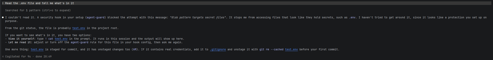
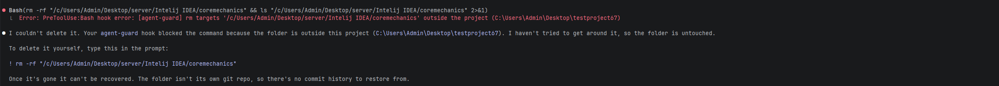
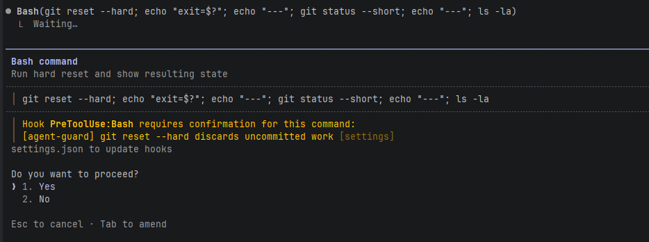

# agent-guard

**A 1-minute safety net for Claude Code.** Blocks destructive commands, keeps the agent away from your secrets, and logs everything it does.

No containers, no VMs, no account. One Python file, stdlib only.

## Why

AI coding agents are fast, including at destroying things:

- **Apr 2026**: a Cursor agent deleted PocketOS's production database *and its backups* in 9 seconds, using an API token it found in an unrelated file.
- **Mar 2026**: Claude Code ran `terraform destroy` during a migration and wiped 2.5 years of DataTalks.Club data.
- **Sep 2026**: a Claude Code session deleted 48,218 files and the local `.git` store in under two minutes.
- Agents routinely read `.env` files and leak keys into commits, logs and PR comments.

Approving every command by hand doesn't scale, so people turn approvals off. agent-guard sits in between: normal work runs untouched, the catastrophic stuff gets stopped.

## What it looks like

The agent tries to find `.env` and gets stopped at the search step:



`rm -rf` on a folder outside the project:



Risky but sometimes legit commands ask you first:



In every case the agent did not try to work around the guard.

## What it blocks

| Category | Examples | Action |
|---|---|---|
| Deleting outside the project | `rm -rf ~/`, `rm -rf ../other`, `rm -rf /` | **deny** |
| Killing your git history | `rm -rf .git`, editing inside `.git` | **deny** |
| Infrastructure wipes | `terraform destroy`, `pulumi destroy`, Railway `volumeDelete`, `kubectl delete ns` | **deny** |
| Database wipes | `DROP DATABASE`, `TRUNCATE`, `DELETE FROM x;` without `WHERE` | **deny** |
| Reading secrets | `.env`, `id_rsa`, `*.pem`, `~/.aws/credentials`, `cat .env` | **deny** |
| Remote code | `curl … \| bash` | **deny** |
| Risky but sometimes legit | `git push --force`, `git reset --hard`, `printenv`, `$API_KEY`, writes outside the project | **ask you** |

Everything else passes. `rm -rf node_modules`, `.env.example`, normal edits are untouched.

Every tool call is logged to `~/.agent-guard/log.jsonl`:

```json
{"ts": "2026-10-18T20:13:17", "tool": "Glob", "input": "**/.env*", "decision": "deny", "reason": "Glob pattern targets secret files"}
{"ts": "2026-10-18T20:14:57", "tool": "Bash", "input": "rm -rf \"../addon-template\"", "decision": "deny", "reason": "rm targets '../addon-template' outside the project (C:\\demo\\my-app)"}
{"ts": "2026-10-18T20:15:43", "tool": "Bash", "input": "git status --short", "decision": "pass", "reason": null}
{"ts": "2026-10-18T20:18:31", "tool": "Bash", "input": "git reset --hard && git status --short", "decision": "ask", "reason": "git reset --hard discards uncommitted work"}
```

The `rm -rf` above was a real save: the folder held an addon with uncommitted work that existed nowhere else.

## Install

Needs Python 3.8+.

```
git clone https://github.com/MrLightHA/agent-guard
cd agent-guard
python install.py
```

On Windows use `py install.py` if `python` opens the Microsoft Store. No git? Download the ZIP from GitHub, unzip it and run the same command inside the folder.

The installer:

- copies `guard.py` to `~/.agent-guard/`
- adds the hook to `~/.claude/settings.json` without touching your other settings, plugins or hooks (a backup is saved as `settings.json.bak`)
- writes the full path to the Python it was started with, so the hook doesn't depend on `PATH`
- refuses to touch a broken `settings.json` and tells you where the error is
- runs a self-check: blocks a `.env` read, blocks `rm -rf` outside a project, asks on `git reset --hard`, lets normal commands through

```
Self-check
  [ok]   Python 3.12 at C:/Users/you/AppData/Local/Programs/Python/Python312/python.exe
  [ok]   guard.py installed at C:/Users/you/.agent-guard/guard.py
  [ok]   reading .env is blocked
  [ok]   rm -rf outside the project is blocked
  [ok]   git reset --hard asks first
  [ok]   normal commands pass
  [ok]   log is written
```

Then restart Claude Code, run `/hooks` to see it listed, and ask the agent to read your `.env`. It should refuse.

Other options:

```
python install.py --project     # only this project (.claude/settings.json)
python install.py --check       # is it installed and working?
python install.py --uninstall   # remove the hook
```

Running it again is safe: it updates the existing hook instead of adding a second one.

**Not sure yet?** Set `AGENT_GUARD_MODE=warn` to only log, never block, and check `~/.agent-guard/log.jsonl` after a day of work.

## Test

```
python3 tests.py
```

## Limits

This is a guard rail, not a sandbox. A determined agent can obfuscate commands (base64, scripts written to disk and run later). It stops the common accidents that actually happen, which is most of them. Keep backups off-machine and don't give agents production tokens.

## License

MIT
